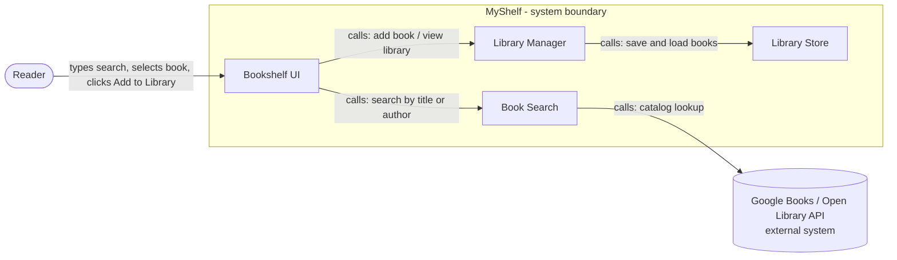

# Architecture v1: MyShelf

ISE4133 Software Engineering, Week 5 | Architecture v1 / M3 preparation

## Worksheet 1: Structure

**Team / product / members / date:** Team 5 / MyShelf / Maftuna (12236681), Nilufar (12244989) / 2026-10-04
**Writer:** Nilufar **Reviewer:** Maftuna

**Input source:** Week 4 file `M2_Story_Slice: MyShelf` (2026-09-29), plus the M1 Product Vision. 

**One user task / feature:** A reader searches for a book by title or author and adds it to her personal library (story S1).
**Scope boundary (one excluded capability):** Social activity feeds and public reviews (excluded in M1 and M2). For this diagram, changing a book's status to "Finished" and the page-count milestone (story S2) are also left out and handled later.

### Requirement and acceptance-criterion IDs

| ID | Required behavior / observable expected result |
|---|---|
| S1 | As a recreational reader, I want to search for a book by title or author and add it to my personal library, so that I can track my reading collection without manual data entry. |
| S1-AC1 | Given the user is on the book search page and types "Little Women", when they execute the search, then a list of results retrieved from the API is displayed, at least one result has the title "Little Women", and every result shows a title, an author and a cover image. |
| S1-AC2 | Given the user selects a book from the search results, when they click "Add to Library", then the book is placed in the default shelf "Want to Read" and appears on the visual bookshelf display. |

### Structure diagram (logical view)

**Components and responsibilities**

| Component | Responsibility |
|---|---|
| Bookshelf UI | Takes the reader's input. Shows the search results list, the error message, and the visual bookshelf with the "Want to Read" shelf. |
| Book Search | Takes a search term, asks the external catalog, and returns results in one simple format (title, author, cover image). Reports an error state if the catalog is unavailable. |
| Library Manager | Holds the library rules needed for S1, including adding a book to the default shelf "Want to Read". Rules for moving books between shelves will be handled in the later S2 work. |
| Library Store | Saves and loads the reader's books and their shelves. |
| Google Books / Open Library API (external) | Outside our boundary. Provides the book data. We do not control it. |

**Arrow legend:** `A --> B` means "A uses/calls B". Returned data is not drawn as a second arrow. This is a logical view only. It does not mean separate servers or services; all four components can live in one web app.

**Criterion 1 path (S1-AC1):** Reader types "Little Women" → Bookshelf UI → (search by title or author) Book Search → catalog API. Book Search converts the response into a list where every item has a title, author and cover image, and returns it. **Bookshelf UI shows the results list.**

**Criterion 2 path (S1-AC2):** Reader selects a result and clicks "Add to Library" → Bookshelf UI → (add book) Library Manager. Library Manager places the book on the default shelf "Want to Read" → (save) Library Store. Bookshelf UI then reads the shelves through Library Manager. **Bookshelf UI shows the book on the visual bookshelf under "Want to Read".**

**Alternate case (from M2, catalog unavailable or error):** Book Search returns an error state instead of results. Bookshelf UI shows no results list and the message that the search could not be completed. Library Manager and Library Store are not called, so the library is unchanged.

**Known constraints, assumptions, and one unresolved rule**
- Constraint: no accounts or social features; personal use only. Search uses a free public book API (M1).
- Assumption: the catalog returns title, author and cover image as required for S1. Page count will be needed later for S2-AC2.
- Assumption: for v1 the library is stored in the browser or app; the storage method is not decided yet.
- **Unresolved rule (from M2):** whether the error message includes a "Try again" option, and whether previously loaded results stay visible.

These are planned paths, not evidence that code has run.

---

## Worksheet 2: One decision

**Decision D1:** All access to the external book catalog goes through one component, Book Search, instead of the Bookshelf UI calling the API directly.

**Related requirement / criterion IDs and the need they create:** S1-AC1 and the M2 alternate case. S1-AC1 requires every result to show title, author and cover, and the alternate case requires a clear error when the API fails. We need one place that turns API data into that format and handles errors.

**Option A:** Bookshelf UI calls Google Books or Open Library directly and handles the response itself.
**Option B:** Bookshelf UI calls Book Search, which calls the API and returns one uniform result format or an error state.

**Chosen option and reason:** Option B. The quality attribute that matters is **modifiability**. We have not chosen between Google Books and Open Library, and small testing found that some results, such as Uzbek ones, are noisier. With Option B the source can be changed or combined by editing only Book Search.

**Trade-off**
- **Benefit:** the data source can change without touching the UI. Fixed sample data can replace the API for the prototype and for tests. The "required fields" rule from S1-AC1 and the error handling live in one place.
- **Cost:** one more component to build, plus code that converts API data into our own format. For a small two-person project this is extra work.
- **Reconsider when:** the team commits to a single API for the whole project and time becomes very short. Then calling the API directly could be enough.

**Assumption behind the choice:** both candidate APIs can supply title, author and cover image in a way that can be mapped to one format. Page count will be checked later when S2 is developed.

**Next check and evidence to look for:** Search "Little Women" in both APIs and check that title, author, cover and page count are present, and that the same mapping works for both. Then, in the prototype, replace the API with fixed sample results and see whether the UI works unchanged. This is a planned check and has not been done yet.

---

## Five-minute peer review and save

Tick a box only after the team has actually checked it.

- [x] Both criteria can be traced through named responsibilities to visible results.
- [x] Arrows are labeled; their direction and the system boundary are clear.
- [x] D1 compares alternatives and explains a quality benefit and a real cost.
- [x] Assumptions and planned checks are distinct from actual evidence.

**Reviewer; ambiguity found; change made (or reason no change was needed):** Reviewer: Maftuna. Ambiguity found: Small Ambiguity found. The Book Search responsibility included page count even though the current architecture focuses on S1. Change made: Removed page count from the current S1 result format and stated that it will be checked later for S2.

**Saved file/location; person who reopened and checked it:** Architecture_v1.md in https://github.com/maftun5/Software-Engineering.git; reopened by Maftuna]

**AI use:** Look in AI_USAGE.md

**Week 6 handoff:** the interaction to develop for the interface/API work is **Bookshelf UI → Book Search (search by title or author)**.
